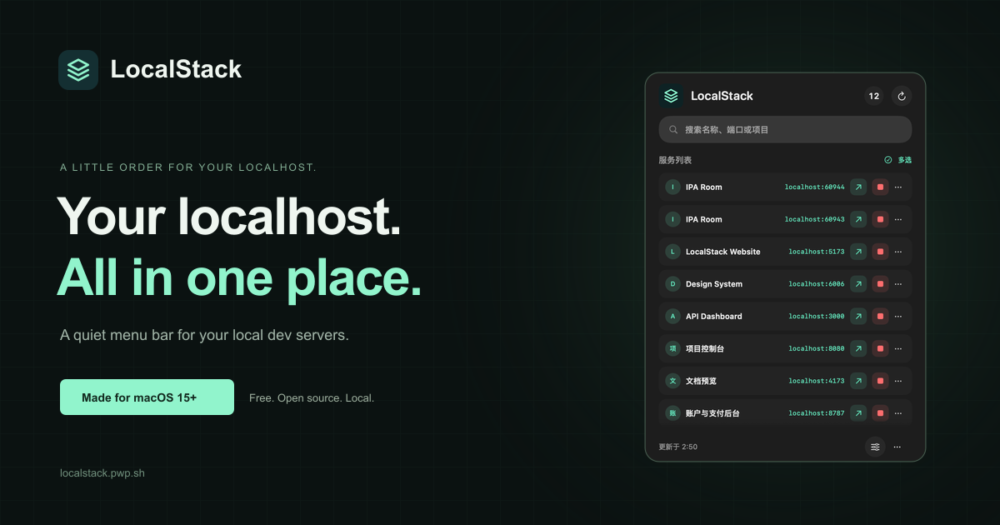

<p align="center">
  <a href="https://localstack.pwp.sh">
    
  </a>
</p>

<h1 align="center">LocalStack</h1>

<p align="center"><strong>Your localhost. All in one place.</strong><br />A quiet, native macOS menu bar for your local development servers.</p>

<p align="center">
  <a href="https://github.com/backrunner/localstack/releases"></a>
  
  
  <a href="LICENSE"></a>
</p>

<p align="center">
  <a href="https://localstack.pwp.sh"><strong>Website</strong></a> ·
  <a href="https://github.com/backrunner/localstack/releases/download/v0.2.3-beta.3/LocalStack-0.2.3-beta.3.dmg"><strong>Download for macOS</strong></a> ·
  <a href="https://localstack.pwp.sh/docs">Documentation</a> ·
  <a href="https://github.com/backrunner/localstack/issues">Report an issue</a>
</p>

<a href="https://localstack.pwp.sh"></a>

LocalStack finds the web pages running on your Mac, checks that they are reachable, and puts them in one focused menu bar panel. Open a site, copy its URL, or stop its process without hunting through terminal tabs. Keep your existing workflow, or add project metadata through Vite, the TypeScript SDK, CLI, or MCP.

## A little order for your localhost

| | |
| --- | --- |
| **Start a server. It shows up.** | Automatically discovers the current user's loopback listeners and independently verifies HTML pages. |
| **Feels at home on your Mac.** | SwiftUI + AppKit, Liquid Glass on macOS 26, system materials on macOS 15, light and dark appearances, and keyboard shortcuts. The Widget extension is a separate source target. |
| **Useful pages, less noise.** | JSON-only APIs, databases, and opaque TCP ports stay out of the default list. |
| **Process actions with checks.** | Revalidates PID, user, start time, and port ownership before stopping a service. Normal stops use `SIGTERM`; force is explicit. |
| **Fits your tools.** | One local Coordinator serves the app, Rust CLI, stdio MCP server, TypeScript SDK, and Vite plugin. |
| **Local by design.** | User-owned Unix socket and private local storage. No LAN scanning or uploading service names, ports, titles, or page contents. |

## Get started

1. **[Download LocalStack 0.2.3-beta.3](https://github.com/backrunner/localstack/releases/download/v0.2.3-beta.3/LocalStack-0.2.3-beta.3.dmg)** — macOS 15+, Apple Silicon and Intel. Currently in Beta.
2. Open the DMG, install LocalStack in Applications, and launch it.
3. Start your development server as usual. Click the stack icon in the menu bar to find your site.

No project plugin is required for automatic discovery. See the **[installation guide](https://localstack.pwp.sh/docs)** and **[discovery troubleshooting](https://localstack.pwp.sh/docs/discovery)**.

Signed installations check for updates daily. Choose Stable or Beta in Settings; installation begins when you click to restart and update. Users of the original `0.2.3-beta.1` need one manual upgrade. Read the [update guide](https://localstack.pwp.sh/docs/updates).

## Bring your workflow

### Vite

Give your server a recognizable name:

```ts
import { defineConfig } from 'vite';
import LocalStack from 'unplugin-localstack/vite';

export default defineConfig({
  plugins: [
    LocalStack({
      name: 'Console',
      projectRoot: process.cwd(),
    }),
  ],
});
```

The package is currently available from this repository, **not published on npm**. Follow the [local package installation and SDK guide](https://localstack.pwp.sh/docs/vite). Registration is fail-open: your dev server continues to start if the Coordinator is unavailable. Registered services still undergo independent page and process validation.

### CLI and MCP

Install the CLI from the repository with `make install-local` (requires Rust), then add `~/.local/bin` to your `PATH`:

```bash
localstack status
localstack list
localstack --json list

# Configure supported coding agents: Codex, Claude Code, Cursor
localstack mcp install --target auto
localstack --json mcp doctor
```

Keep the app running to provide the Coordinator. See the [CLI and MCP guide](https://localstack.pwp.sh/docs/cli) for setup and background operation.

## Build and contribute

Building the app requires **macOS 15+**, **Xcode 26+**, and **Swift 6.2+**. The CLI requires Rust; the TypeScript package requires Node.js 20+.

```bash
git clone https://github.com/backrunner/localstack.git
cd localstack

Scripts/compile_and_run.sh
```

Run the component checks:

```bash
swift build
swift test
cargo test --manifest-path cli/Cargo.toml
npm --prefix packages/unplugin-localstack ci
npm --prefix packages/unplugin-localstack test
```

Create an app bundle with `make package-app`, or a DMG with `make package-dmg`. Packaging uses an available Developer ID certificate; set `SIGN_IDENTITY=-` for a local ad-hoc build. Distribution uses `make release-dmg`, which requires Developer ID signing and Apple notarization. The Release DMG workflow builds tagged versions into verified draft releases. See [release setup](docs/macos-release.md) and [updater internals](docs/auto-updates.md).

For a background-only Coordinator, use `make install-coordinator` / `make uninstall-coordinator`, or run `swift run LocalStackCoordinator` during development.

## Inside the project

| Path | Purpose |
| --- | --- |
| [`Sources/LocalStackApp`](Sources/LocalStackApp) | Menu bar app, panel, settings, deep links, previews |
| [`Sources/LocalStackCore`](Sources/LocalStackCore) | Coordinator, discovery, probing, registry, IPC, process validation |
| [`Sources/LocalStackShared`](Sources/LocalStackShared) | Shared models and JSON-RPC types |
| [`Sources/LocalStackWidget`](Sources/LocalStackWidget) | WidgetKit UI and snapshots |
| [`cli`](cli) | Rust CLI and stdio MCP server |
| [`packages/unplugin-localstack`](packages/unplugin-localstack) | TypeScript SDK and Vite plugin |
| [`website`](website) | Official website and documentation, built with svedocs |
| [`Scripts`](Scripts) | Assets, packaging, installation, LaunchAgent helpers |

The [engineering notes](.agents/README.md) cover architecture, service lifecycle, protocol, and implementation decisions. To work on the website, start with [`website/README.md`](website/README.md).

## License

[MIT](LICENSE) · Built by [backrunner](https://github.com/backrunner).

This is an independent macOS developer tool, unaffiliated with the LocalStack cloud emulator.

## Distribution and Mac App Store

LocalStack is free and MIT licensed. The GitHub DMG includes the menu bar app and embedded Coordinator; the CLI and Widget extension are separate source targets. There is currently no Mac App Store release. The existing app is unsandboxed and uses its own GitHub updater, so it is not ready for store submission. See the [dated App Store readiness assessment](docs/app-store-readiness.md) for evidence and the proposed free store path.

The bilingual website lives in [`website`](website), using svedocs 0.3.0 and SvelteKit 3. Its documentation covers installation, discovery exclusions, single and batch stops, integrations, updates, privacy, and distribution.
